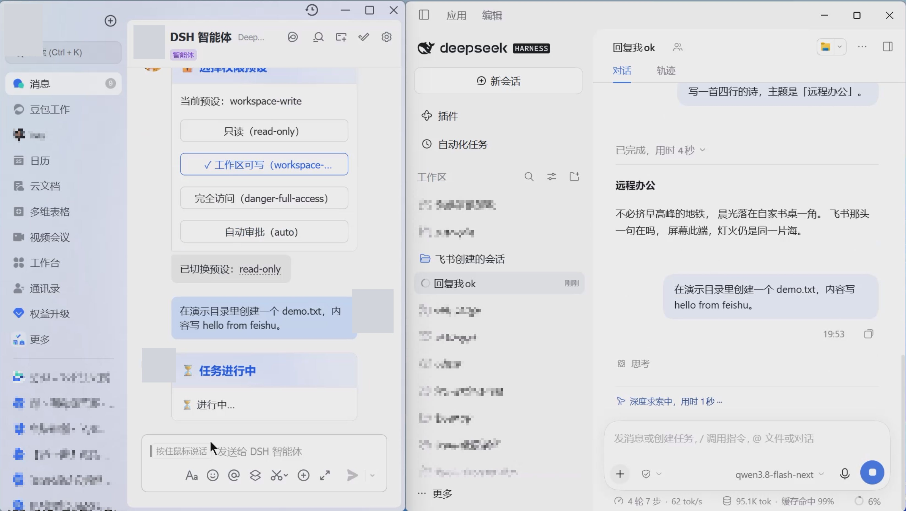
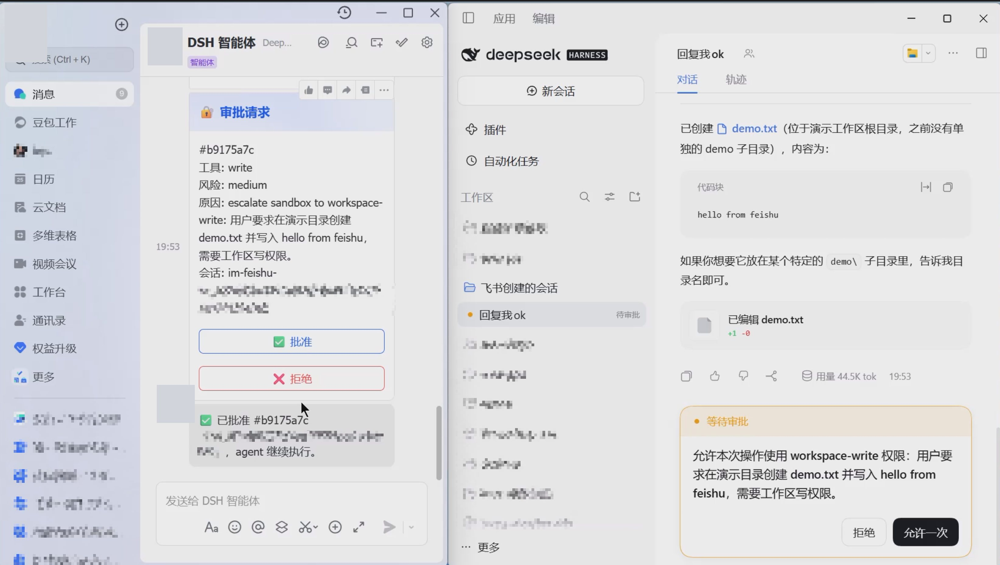
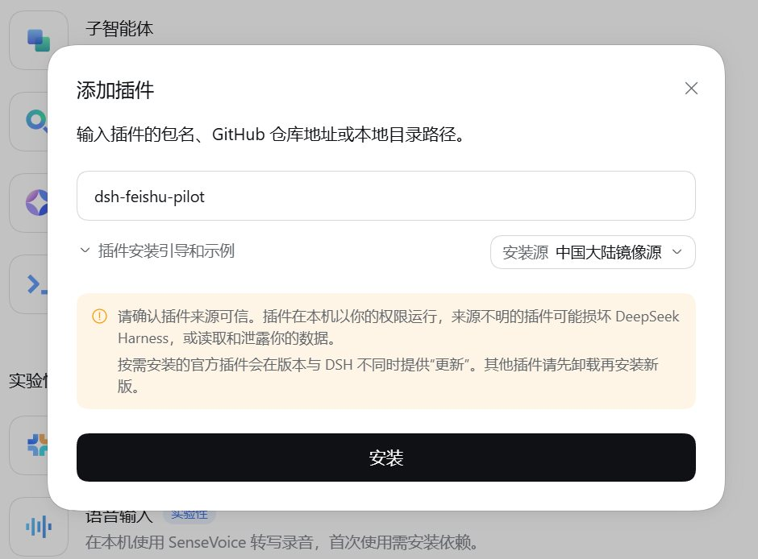
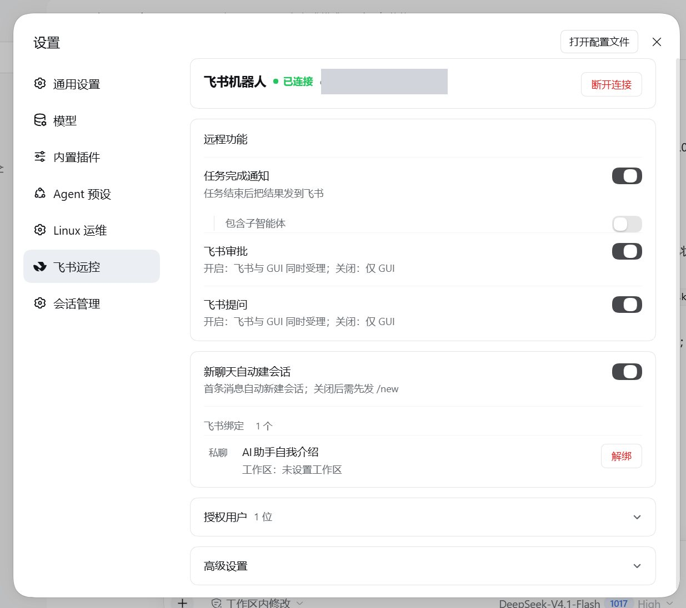
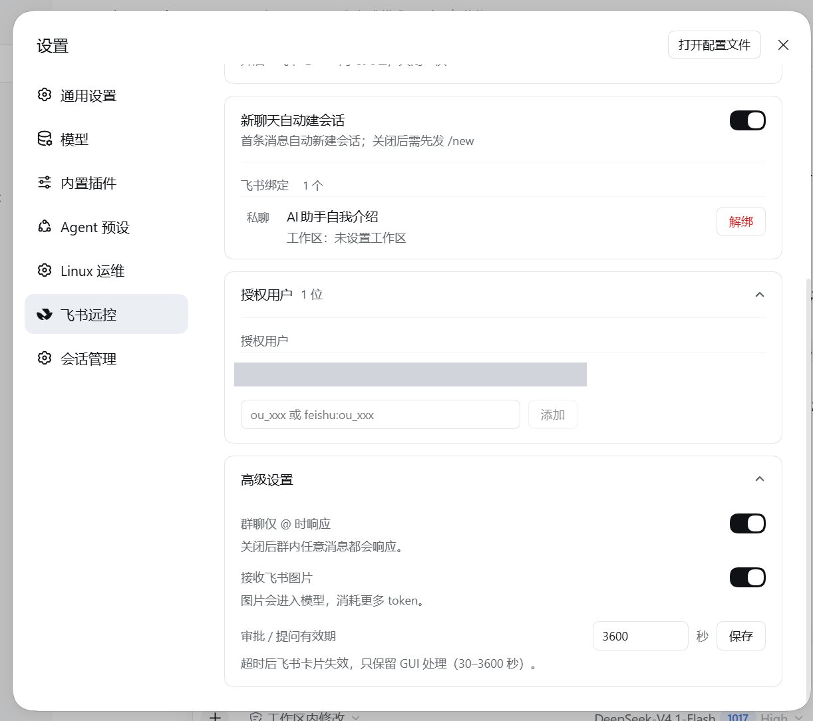

# 飞书远控 · dsh-feishu-pilot

**把飞书变成 DSH 的远程控制台**：桌面 GUI 会话的任务、审批、提问都能在手机上继续；任务结束主动通知；GUI 与飞书双端同时受理。扫码即可接入，离开电脑也不停。

## 界面预览

飞书里远程派活、审批，桌面会话同步执行：





---

## 功能亮点

- **任意会话可远程**：不只飞书创建的会话——桌面 GUI 里的任意会话，任务通知、审批、提问都能推到飞书。
- **审批/提问双端竞速**：GUI 与飞书同时受理，任一端先处理即生效，另一端自动失效并更新卡片。
- **扫码一键接入**：飞书扫码自动创建应用并绑定机器人，预填权限、写入凭据、直接连接，无需手工配置应用。
- **切换会话，GUI 自动跟随**：在飞书 `/ws` 选工作区/会话后，桌面侧栏自动打开对应会话。
- **文件与图片直达模型**：飞书发来的文件自动作为附件（≤20MB/个，单条最多 2 个）；图片可开启（默认关，单条最多 4 张、单张 ≤10MB）。
- **换机器人免重启**：换 bot 后热重连，旧绑定/授权自动清理；同一时间只连一个机器人。
- **进度与结果**：绑定会话用进度卡展示过程与终态（耗时、token），非绑定会话推送任务完成通知。
- **任务中插话**：任务执行中发 `/steer <文本>`（或 `/插话 <文本>`）即可把补充要求插入当前任务，不用等它跑完。
- **多选提问也能答**：飞书收到多选提问后，点「回复编号作答」再回复编号（如 `1,3`）即可完成多选。
- **支持 DSH 原生命令**：`/goal`、`/plan`、`/compact`；另有插件命令 `/new`、`/status`、`/output`、`/ws`、`/steer`、`/approve`、`/permission`、`/model`、`/help`。

## 环境要求

- 已安装并运行的 **DSH**（DeepSeek Harness，Web GUI）；
- 一个飞书账号，且在该企业内**有权限创建/管理自建应用**（通常为企业管理员或被授予开发者权限；扫码自动建应用需要该权限）；
- 应用需以 **企业自建应用** 形式创建并开启 **机器人** 能力；事件订阅使用**长连接**——**长连接仅企业自建应用支持**（应用商店/ISV 应用不支持）；
- 若使用已有机器人：需要该应用的开发者/管理员权限，以便填写 App ID/Secret 或扫码绑定；
- 网络：DSH 所在机器可直接访问飞书开放平台（长连接，无需公网 IP）。

## 安装

通过 **DSH 插件管理器**安装：

1. 打开 DSH → 设置 → **插件管理器**；
2. 按包名 `dsh-feishu-pilot` 搜索并安装，或者直接添加`git+https://github.com/pxvp2008/dsh-feishu-pilot.git`；
3. 安装完成后**重启 DSH**。

运行依赖（飞书 SDK、qrcode）会自动安装，不需要单独处理。



### 让 AI Agent 安装

把下面这句话直接发给你的 AI Agent：(强烈建议还是通过**DSH 插件管理器**安装)

```text
从 https://github.com/pxvp2008/dsh-feishu-pilot.git 安装 DSH 插件 dsh-feishu-pilot
```

## 快速开始

1. 打开 DSH → 设置 → **飞书远控**；
2. 点「扫码连接」，用飞书扫码创建/选择机器人（或手动填 App ID/Secret）；
3. 连接成功后，飞书私聊机器人发一条任务 —— 手机端即可远程操作桌面会话；
4. 群聊使用时需 **@机器人**（默认；可在高级设置关闭）。

## 飞书应用配置

扫码模式会自动预填以下权限；手动配置应用时请自行开通：

| 权限 | 用途 |
|---|---|
| `im:message:send_as_bot` | 发消息 / 卡片 |
| `im:message.p2p_msg:readonly` | 接收私聊消息 |
| `im:message.group_at_msg:readonly` | 接收群聊 @ 消息 |
| `im:message:readonly` | 下载图片（图片入模型） |
| `im:resource` | 上传文件（`/output`） |
| `application:application:self_manage` | 查询本应用权限（自动检查缺失权限） |
| `application:app_slash_command:read` / `write` | 斜杠命令面板 |

可选：`im:message.group_msg`（敏感权限）。关闭「群聊仅 @」后，设置页会自动检查并只提示真正缺失的权限。

- **事件订阅**：`im.message.receive_v1`（长连接模式）；
- **卡片回调**：`card.action.trigger`；
- 创建版本并发布应用，把机器人加入可用范围（群聊使用需拉入群）。

## 常用命令

| 命令 | 说明 |
|---|---|
| `/ws` | 工作区 / 会话选择器（接管或新建） |
| `/new` | 新建会话（飞书专用工作区） |
| `/status` | 连接、绑定、审批、授权状态 |
| `/output` | 上一任务的完整输出 |
| `/approve <id> yes\|no` | 文本方式处理审批 |
| `/steer <文本>` | 插话：把内容插入当前正在执行的任务（别名 `/插话`；空闲时等同普通消息） |
| `/goal` | 设置长期任务目标 |
| `/plan [off\|消息]` | 计划模式开关 |
| `/compact` | 压缩对话 |
| `/permission` | 权限预设（按钮选择） |
| `/model` | 模型选择（按钮卡） |
| `/help` | 帮助 |

## 设置页

DSH 设置 → **飞书远控**，一页管理，**修改即时生效**：

- **连接**：二维码扫码 / 手动凭据 / 断开（二次确认）；
- **远程功能**：任务通知、审批、提问开关，含子智能体开关；
- **会话**：自动建会话、绑定列表（可解绑）、绑定会话名（只读）；
- **授权用户**：当前用户 + 待批准列表（一键批准/忽略）；首次连接后的**首个来信用户会自动成为管理员**；
- **高级设置**：群聊仅 @、接收图片、审批/提问有效期。

日常配置全部可在设置页完成，无需修改文件。





## 隐私与安全

- **凭据只在你的机器上**：扫码/手填的飞书 App Secret 只写入本机插件状态目录（写入时请求 0600 权限：类 Unix 生效；Windows 下由用户目录 ACL 限制），不经浏览器、不上传任何第三方；
- **运行数据本地化**：会话绑定、审批/提问记录、日志全部保存在本机的插件数据目录；
- **无遥测**：插件不收集、不上报任何使用数据；
- 断开连接会清除本地凭据并停止推送。

## 故障排查

| 现象 | 处理 |
|---|---|
| 设置页显示未连接 | 检查网络与凭据；重新扫码或手填 App ID/Secret |
| 群聊里机器人不响应 | 默认仅响应 @ 消息；确认已 @机器人且应用开通群消息权限 |
| 收不到审批/提问卡 | 确认设置页对应开关开启；检查该会话的审批策略是否过于宽松 |
| 飞书切换后 GUI 没跟随 | 保持 DSH 页面打开；若页面长时间后台可能超时，飞书会提示手动打开 |
| 设置页空白 / 旧页面报错 | 页面停留在旧版本时刷新一次（插件更新后需刷新） |
| 升级后无绑定 | 状态目录在升级时自动迁移，正常无需重扫码；异常时查看插件日志 |

日志与数据都保存在本机的插件目录中，排障时可查看插件日志。

## 代码结构

```
index.js             宿主装配：配置合并、启动编排、RPC 与工具注册（插件入口）
cordis.patch.yml     插件装配声明（实例 id / name 与默认配置说明）
lib/identity.js      身份与路径单一事实源（包名、状态目录、RPC 前缀、旧目录迁移）
lib/boot.js          启动编排：初始化会话运行时与飞书接入
lib/core/            会话运行时（消息处理、渲染、审批、通知、待批准、会话映射）
lib/feishu/          飞书接入（长连接渠道、凭据、扫码建应用、断线重连）
lib/client.js        浏览器半部：设置页 UI 与桌面跟随导航
lib/*.js             桥接、命令、卡片、工作区切换、通知、审批/提问处理、RPC 路由等
locale/              中英文案
assets/              图标资源
```

- **宿主半部**：`index.js` + `lib/`（运行在 DSH 宿主进程）；
- **浏览器半部**：`lib/client.js`（由 `package.json` 的 `exports["./client"]` 暴露，并声明 `dsh.client` 元数据）。

## License

MIT License，见 [LICENSE](LICENSE)。
